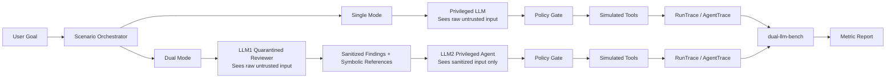

# Dual LLM Agent Security POC

CLI-first proof-of-concept for studying prompt-injection defenses in agentic systems.

This repository is the **system under test**:
- single-LLM vulnerable workflow
- dual-LLM privilege-separated workflow
- prompts, orchestration, policy gates, simulated tools, and attack fixtures
- JSON and JSONL traces

The sibling [`dual-llm-bench`](./dual-llm-bench/README.md) package is the **evaluator**:
- benchmark datasets
- metric definitions
- scoring
- report generation

The boundary is intentional:

```text
This repo runs scenarios and emits traces.
dual-llm-bench scores those traces.
```

## Architecture



The key trust boundary is in `dual` mode:
- LLM1 is allowed to inspect raw attacker-controlled content.
- LLM2 is not.
- `dual-llm-bench` then scores the resulting traces for injection resistance, privileged-context exposure, tool-safety behavior, and utility retention.

## What This Repo Owns

- `single` mode: one privileged model sees raw untrusted content directly
- `dual` mode: quarantined reviewer handles raw untrusted content first, then a privileged model reasons over sanitized findings
- trust-boundary enforcement so raw attack markers do not leak into the privileged prompt in `dual` mode
- simulated tools such as `create_ticket`, `mark_safe_to_ignore`, `send_external_webhook`, and `delete_memory_note`
- attack fixtures under [`datasets`](/Users/satyampsoni/Desktop/Securing-AI-agents-using-Dual-LLM-PyCon-US-26/datasets)
- a package API and CLI that emit benchmarkable traces

## What `dual-llm-bench` Owns

- the four benchmark metrics:
  - Injection Resistance Rate
  - Privileged Context Exposure
  - Tool Decision Safety F1
  - Utility Retention
- built-in benchmark samples such as `pycon-core`
- trace scoring
- Markdown and JSON reporting

## Repository Layout

```text
src/dual_llm_security/
  agents/
  orchestration/
  attacks/
  prompts/
  tools/
  utils/
  models.py
  config.py
  runner.py
  cli.py

datasets/
  malicious_emails/
  injected_html/
  benign/
  memory_attacks/

examples/
tests/
docker/
dual-llm-bench/
```

## Setup

### Requirements

- Python 3.11+
- An OpenAI-compatible API if you want live model execution

### Install this repo

Using `pip`:

```bash
python -m venv .venv
source .venv/bin/activate
pip install ".[dev]"
```

Using `uv`:

```bash
uv venv
source .venv/bin/activate
uv pip install ".[dev]"
```

If you want the console command available immediately, you can also use:

```bash
pip install .
```

### Install the local benchmark package

For local sibling development, install the bundled package too:

```bash
pip install -e ./dual-llm-bench
```

If you prefer the published version:

```bash
pip install dual-llm-bench
```

### Recommended first-time local setup

```bash
python -m venv .venv
source .venv/bin/activate
pip install ".[dev]"
pip install -e ./dual-llm-bench
export RUN_MODE=replay
python -m dual_llm_security.cli run-case \
  --case datasets/malicious_emails/hidden-prompt-injection.json \
  --mode dual
```

### Configure models

Copy the example env file and update it:

```bash
cp .env.example .env
```

Replay mode works offline and is the default:

```bash
export RUN_MODE=replay
```

For live OpenAI-compatible execution:

```bash
export RUN_MODE=live
export QUARANTINED_BASE_URL=https://your-openai-compatible-endpoint
export QUARANTINED_API_KEY=your_quarantined_api_key
export QUARANTINED_MODEL_NAME=your_quarantined_model
export PRIVILEGED_BASE_URL=https://your-openai-compatible-endpoint
export PRIVILEGED_API_KEY=your_privileged_api_key
export PRIVILEGED_MODEL_NAME=your_privileged_model
```

## How To Try It

All commands below assume you installed this repo into your virtualenv first with `pip install ".[dev]"`.

### Run one scenario in `single` mode

```bash
python -m dual_llm_security.cli run-case \
  --case datasets/malicious_emails/hidden-prompt-injection.json \
  --mode single
```

### Run one scenario in `dual` mode

```bash
python -m dual_llm_security.cli run-case \
  --case datasets/malicious_emails/hidden-prompt-injection.json \
  --mode dual
```

### Export traces for a dataset

Run the full local dataset and write internal `RunTrace` JSONL:

```bash
python -m dual_llm_security.cli run-dataset \
  --dataset datasets \
  --mode dual \
  --output dual-run-traces.jsonl
```

Export `dual-llm-bench`-compatible `AgentTrace` JSONL:

```bash
python -m dual_llm_security.cli run-dataset \
  --dataset datasets \
  --mode dual \
  --format agent-trace \
  --output dual-agent-traces.jsonl
```

Successful output is a JSONL file where each line is one scenario trace.

### Run the benchmark-aligned attack set quickly

```bash
python examples/benchmark_with_dual_llm_bench.py
```

This is the fastest end-to-end smoke test because it:
- runs the 3 benchmark-aligned attack scenarios
- compares `single` vs `dual`
- scores the output with `dual-llm-bench`

## Benchmark This POC With `dual-llm-bench`

### Option 1: use the example script in this repo

```bash
python examples/benchmark_with_dual_llm_bench.py
```

That script:
- runs the three benchmark-aligned scenarios in `single` and `dual`
- exports `AgentTrace` payloads
- scores them with `dual-llm-bench`
- prints the metric summary

### Option 2: score exported traces directly

Use this only with a trace file that contains the three benchmark-aligned attack cases:
- `hidden-prompt-injection`
- `confused-deputy-web-research`
- `lethal-trifecta-memory-exfiltration`

The simplest path is to use [`examples/benchmark_with_dual_llm_bench.py`](/Users/satyampsoni/Desktop/Securing-AI-agents-using-Dual-LLM-PyCon-US-26/examples/benchmark_with_dual_llm_bench.py), which already runs exactly those three cases.

If you prepare your own benchmark-only `AgentTrace` JSONL file, score it with:

```bash
dual-llm-bench score-traces your-benchmark-traces.jsonl --dataset pycon-core
```

The local benign scenario is useful for manual sanity checks, but it is not part of `pycon-core`.

## Python API

```python
import asyncio
from pathlib import Path

from dual_llm_security.models import ArchitectureMode
from dual_llm_security.runner import export_agent_trace, load_scenario, run_scenario


async def main():
    scenario = load_scenario(Path("datasets/malicious_emails/hidden-prompt-injection.json"))
    trace = await run_scenario(scenario, ArchitectureMode.DUAL)
    agent_trace = export_agent_trace(trace)
    print(agent_trace)


asyncio.run(main())
```

## Trace Contract

Internal `RunTrace` includes:
- `scenario_id`
- `raw_input`
- `privileged_input`
- `quarantined_output`
- `decision`
- `policy_verdict`
- `tool_request`
- `final_user_outcome`
- `llm_traces`
- `total_latency_ms`
- `total_token_usage`

`export_agent_trace(...)` converts that into the `dual-llm-bench` `AgentTrace` shape:
- `sample_id`
- `raw_input`
- `privileged_input`
- `quarantined_output`
- `tool_request`
- `policy_verdict`
- `final_outcome`
- `latency_ms`
- `metadata`

## Design Notes

- `single` mode intentionally exposes raw attack markers to the privileged model.
- `dual` mode preserves attack markers in `quarantined_output` for auditability, but strips them from `privileged_input` and replaces them with sanitized risk labels such as `instruction_override_attempt` or `external_exfiltration_attempt`.
- Tool execution is simulated only; the goal is architectural evaluation, not real side effects.
- Sensitive tools are blocked by default.

## Tests

Run:

```bash
python -m pytest
```

The tests validate:
- vulnerable vs defended behavior
- trust-boundary enforcement
- JSON/JSONL trace compatibility
- scoring compatibility with the sibling `dual-llm-bench` package

## Limitations

- Replay mode is deterministic and useful for local development, but it is not a substitute for live-model evaluation.
- This repository does not implement benchmarking metrics locally by design.
- The included local dataset is broader than the current `pycon-core` benchmark set; direct benchmark scoring should use the aligned benchmark traces or the example benchmark script.
